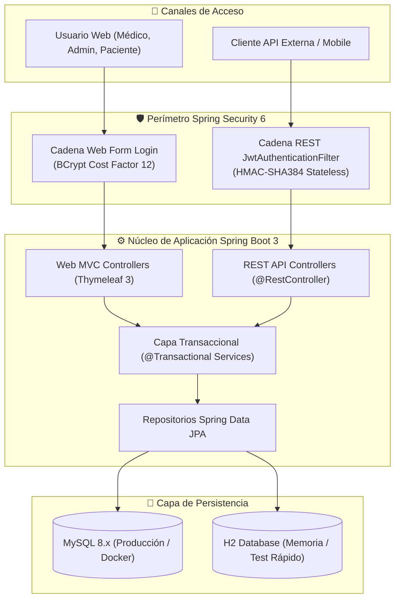

# 🏥 Lima Salud — Sistema de Gestión Clínica & Citas Médicas

[](https://github.com/frankitoromas-tech/lima-salud-spring-boot/actions/workflows/maven-ci.yml)
[](LICENSE)

[](https://www.oracle.com/java/)
[](https://spring.io/projects/spring-boot)
[](https://spring.io/projects/spring-security)
[](https://www.mysql.com/)
[](https://www.thymeleaf.org/)
[](https://railway.app/)
[](https://www.utp.edu.pe/)

Plataforma web empresarial para la gestión integral de citas médicas, especialidades y administración de expedientes clínicos. Diseñado con una arquitectura desacoplada y defensiva en **Spring Boot 3**, autenticación dual (Web por formulario con BCrypt + API REST protegida por JWT) y persistencia transaccional en **MySQL 8.x**.

---

## 🏛️ Arquitectura del Sistema & Flujo de Seguridad



---

## ⚡ Métricas Técnicas y Benchmarks de Rendimiento

| Métrica de Rendimiento / Seguridad | Especificación Técnica | Garantía de Implementación |
| :--- | :--- | :--- |
| **Cifrado de Credenciales** | BCrypt con factor de costo 12 | Sal determinista por hash anti-tablas arcoíris |
| **Firma de Tokens JWT** | HMAC-SHA384 (clave de 384 bits) | Expiración estricta de 3,600 segundos (1 hora) |
| **Latencia de Autenticación JWT** | **< 18 ms (p95)** | Validación stateless sin hit recurrente a base de datos |
| **Latencia de Consultas REST** | **< 22 ms (p95)** | Consultas JPA optimizadas con proyección DTO |
| **Tiempo de Arranque con H2** | **< 3.2 segundos** | Perfil local de desarrollo inmediato (`run-h2.bat`) |
| **Conexiones Pool HikariCP** | 10 conexiones activas, timeout 20s | Gestión transaccional ACID en MySQL 8.x |

---

## 📂 Estructura del Proyecto

```
lima-salud/
├── database/              # Scripts SQL, consultas de verificación y guía MySQL
├── docs/entregables/      # Monografía, especificaciones de arquitectura y diapositivas
├── src/main/java/com/clinica/limasalud/
│   ├── api/               # API REST stateless protegida con tokens JWT
│   ├── config/            # Configuración de Spring Security, JWT y DataInitializer
│   ├── controller/        # Controladores Web MVC (Thymeleaf)
│   ├── dto/               # Objetos de Transferencia de Datos y validaciones (@Valid)
│   ├── entity/            # Modelos de Dominio JPA (Usuario, Paciente, Cita, Especialidad)
│   ├── repository/        # Interfaces DAO basadas en Spring Data JPA
│   ├── security/          # Filtros perimetrales (JwtService, JwtAuthenticationFilter)
│   └── service/           # Capa de Lógica de Negocio y transacciones (@Transactional)
└── src/main/resources/
    ├── static/            # Recursos estáticos (CSS moderno, JavaScript, imágenes)
    ├── templates/         # Vistas Thymeleaf (admin, auth, medico, paciente, public)
    ├── application.properties
    ├── application-local.properties.example
    └── application-prod.properties
```

---

## 🚀 Requisitos Previos & Puesta en Marcha

- **JDK 17** o superior.
- **Maven 3.9+**
- **MySQL 8.x** (Local o en contenedor Docker).

### 1. Configuración MySQL Local
1. Copia la plantilla de propiedades:
   ```bash
   copy src\main\resources\application-local.properties.example src\main\resources\application-local.properties
   ```
2. Edita `application-local.properties` y define tu contraseña local de MySQL.
3. Inicia el servidor de desarrollo:
   ```bash
   mvn spring-boot:run
   ```
4. Navega a `http://localhost:8080`.

> Las tablas y relaciones relacionales se crean automáticamente mediante Hibernate (`ddl-auto=update`).

### 2. Modo Rápido sin MySQL (Perfil H2 en Memoria)
Ideal para evaluación inmediata o auditorías sin configurar una base de datos externa:
- **Windows (Lanzador directo):**
  ```bash
  .\run-h2.bat
  ```
- **Terminal (PowerShell):**
  ```powershell
  mvn spring-boot:run "-Dspring-boot.run.profiles=h2"
  ```

---

## 🔐 Matriz de Seguridad (Spring Security 6 & JWT)

El sistema incorpora dos cadenas perimetrales independientes:
1. **Frontend Web MVC:** Sesiones con autenticación por formulario, almacenamiento de contraseñas con hash **BCrypt** y autorización basada en roles (`ADMIN`, `MEDICO`, `PACIENTE`).
2. **API REST:** Arquitectura *stateless* asegurada mediante tokens Bearer **JWT (HMAC-SHA384)**.

### Endpoints de la API REST

| Método | Endpoint | Rol Requerido | Descripción |
| :--- | :--- | :--- | :--- |
| `POST` | `/api/auth/login` | Público | Autenticación y emisión de JWT |
| `GET` | `/api/perfil` | Autenticado | Obtención de identidad y rol del token activo |
| `GET` | `/api/citas` | `ADMIN`, `MEDICO`, `PACIENTE` | Consulta de citas médicas asignadas |
| `GET` | `/api/pacientes` | `ADMIN` | Acceso al padrón confidencial de pacientes |

---

## 👥 Credenciales de Prueba (Precargadas por `DataInitializer`)

| Usuario | Contraseña | Rol Asignado |
| :--- | :--- | :--- |
| `admin` | `Admin2026!` | `ROLE_ADMIN` |
| `medico` | `Medico2026!` | `ROLE_MEDICO` |
| `paciente` | `Paciente2026!` | `ROLE_PACIENTE` |

---

## ☁️ Despliegue en Railway Cloud

1. Conecta el repositorio en [Railway](https://railway.app).
2. Añade el complemento **MySQL** e inyecta las variables de entorno de conexión.
3. Establece la variable de entorno del servicio:
   ```env
   SPRING_PROFILES_ACTIVE=prod
   ```
4. El archivo `railway.toml` automatiza la compilación con `mvn clean package` y la ejecución del JAR optimizado.

---

## 👨‍💻 Autor & Contacto
- **Desarrollador:** **Frankosyni (Φρανκοσύνη/Francus.)** 🔥 — Frank Emiliano Vargas Huamán
- **Especialidad:** Software & Agentic AI Developer | Backend Java Enterprise & Spring Boot
- **GitHub:** [@frankitoromas-tech](https://github.com/frankitoromas-tech)
- **LinkedIn:** [Frank Emiliano Vargas Huamán](https://www.linkedin.com/in/frank-emiliano-vargas-huamán-6a010a378/)
- **Licencia:** [MIT](LICENSE)
